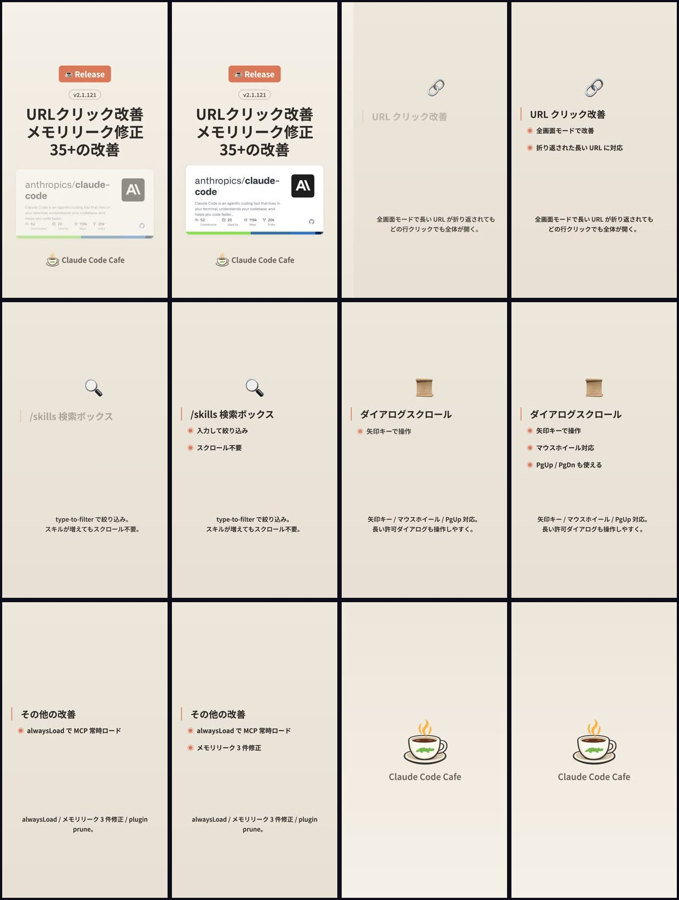

# vshot

[](https://github.com/ClaudeCodeCafe/vshot/actions/workflows/ci.yml)

**Video frame extraction for AI.** One montage image. One `Read()` call. Your AI can now watch videos.

<p align="center">
  
  <br>
  <em>12 frames from a 62-second video → 6×2 grid, 140KB. Portrait auto-detected.</em>
</p>

## The Problem

> AI assistants can read images but can't watch videos. Feeding 20 separate screenshots burns tokens and loses context.

| Without vshot | With vshot |
|---|---|
| Manually screenshot frames | `vshot video.mp4 --montage` |
| Feed 20 images → 20,000+ tokens | Feed 1 montage → ~1,500 tokens |
| No timestamps, no context | Timestamped grid, full flow visible |
| Tedious every time | One command, done |

## How It Works

```
MP4 → ffmpeg extracts frames → timestamps burned in → ImageMagick tiles into grid → 1 image

┌──────┬──────┬──────┬──────┬──────┬──────┐
│ 0:00 │ 0:05 │ 0:11 │ 0:17 │ 0:22 │ 0:28 │
├──────┼──────┼──────┼──────┼──────┼──────┤
│ 0:34 │ 0:39 │ 0:45 │ 0:51 │ 0:56 │ 1:02 │
└──────┴──────┴──────┴──────┴──────┴──────┘
              → montage.jpg (one image!)
```

Aspect ratio is auto-detected. Portrait (9:16) and landscape (16:9) videos are handled correctly — no stretching.

## Modes

| Mode | Resolution | Use case |
|------|-----------|----------|
| `overview` | 480×270 | "What's in this video?" |
| `text` | 960×540 | Read UI text, code, terminals |
| `detail` | 1280×720 | Design review, pixel inspection |

## Install

### Option A: Homebrew (Recommended)

```bash
brew tap ClaudeCodeCafe/tap
brew install vshot
```

Installs vshot with ffmpeg and ImageMagick as dependencies. Done.

### Option B: Claude Code Plugin

```bash
/plugin marketplace add ClaudeCodeCafe/vshot
/plugin install vshot@vshot
```

Then use directly:

```
/watch video.mp4
/watch video.mp4 --mode text
/vshot:setup
```

`/vshot:setup` can also install a `vshot` shim into `~/.local/bin` so the CLI works from any shell — the shim resolves the latest installed plugin version at runtime, so it survives plugin updates.

### Option C: Manual

```bash
# Prerequisites
brew install ffmpeg imagemagick

# Clone and link
git clone https://github.com/ClaudeCodeCafe/vshot.git
ln -s "$(pwd)/vshot/vshot" /usr/local/bin/vshot

# Or curl
curl -o /usr/local/bin/vshot https://raw.githubusercontent.com/ClaudeCodeCafe/vshot/main/vshot
chmod +x /usr/local/bin/vshot
```

## Usage

```bash
# Create montage (most common)
vshot video.mp4 --montage

# Text-readable montage
vshot video.mp4 --montage --mode text

# Just extract frames (no grid)
vshot video.mp4 --frames 20

# Every 5 seconds
vshot video.mp4 --montage --interval 5

# High detail, more frames
vshot video.mp4 --montage --mode detail --frames 30

# Clean up individual frames after montage
vshot video.mp4 --montage --cleanup

# Scene detection — only extract frames where the visual content changes
vshot video.mp4 --scene --montage

# Stricter scene detection (fewer frames)
vshot video.mp4 --scene 0.5 --montage

# Pinpoint extraction — re-examine specific moments (seconds, decimals OK;
# fractional times are labelled with one decimal, e.g. 0:03.5)
vshot video.mp4 --at 3.5,12,48 --mode detail --montage

# Fixed grid columns (useful for portrait videos)
vshot video.mp4 --montage --cols 4

# Stable montage file name for pipelines (re-runs overwrite it)
vshot video.mp4 --at 3.5,12,48 --montage --name review

# Machine-readable result for pipelines
vshot video.mp4 --montage --cleanup --json | jq -r .montage
```

### Options

| Flag | Description | Default |
|------|------------|---------|
| `--montage` | Combine into single grid image | off |
| `--mode` | overview / text / detail | overview |
| `--frames N` | Number of frames | 20 |
| `--interval N` | Extract every N seconds | — |
| `--scene [N]` | Extract only scene-change frames (0.0-1.0) | 0.3 |
| `--at LIST` | Extract at specific times in seconds (e.g. `3.5,12,48`) | — |
| `--cols N` | Montage grid columns | auto |
| `--name NAME` | Montage file name (no directory, `.jpg` added) — stable names for pipelines | `<video>_montage_<run-id>.jpg` |
| `--output DIR` | Custom output directory | `<video>_vshot/` |
| `--cleanup` | Remove frames after montage | off |
| `--no-timestamps` | Skip timestamp overlay | — |
| `--json` | Print JSON result line to stdout (progress → stderr) | off |

## Scene Detection

`--scene` uses ffmpeg's scene change detection to extract only the frames that matter — skipping duplicates and static content.

<table>
<tr>
<th>vshot video.mp4 --montage (uniform)</th>
<th>vshot video.mp4 --scene --montage (smart)</th>
</tr>
<tr>
<td></td>
<td></td>
</tr>
<tr>
<td>12 frames, 140KB — includes duplicates</td>
<td>5 frames, 76KB — only key moments</td>
</tr>
</table>

Same video. Fewer frames. Zero redundancy.

## Timestamps That Never Disappear

Frame→time mapping survives even on minimal setups, via a three-level fallback:

1. **Burn-in** — ffmpeg `drawtext` overlays `M:SS` on each frame
2. **ImageMagick annotate** — used automatically when `drawtext` is unavailable (e.g. Homebrew ffmpeg builds without freetype)
3. **Filenames + montage labels** — every frame filename embeds its timestamp (`frame_0003_t0m12s.jpg`); if both burn-ins fail, the montage renders timestamps as labels under each cell

## Machine-Readable Output

`--json` keeps human-readable progress on stderr and prints one JSON line to stdout:

```bash
vshot video.mp4 --montage --cleanup --json | jq
```

```json
{
  "video": "video.mp4",
  "duration": 62.3,
  "mode": "overview",
  "frames": 12,
  "output_dir": "/abs/path/video_vshot",
  "montage": "/abs/path/video_vshot/video_montage_123_456.jpg",
  "files": [{"path": "...frame_0001_t0m00s.jpg", "time": 0.00}]
}
```

No more globbing for `*_montage_*.jpg` in pipelines — `jq -r .montage` and done.

## Token Efficiency

| Approach | Images to read | ~Tokens | File size |
|----------|---------------|---------|-----------|
| Manual screenshots | 5-10 | 5,000-10,000 | 5-10 MB |
| Frame dump | 20 | 20,000+ | 2+ MB |
| **vshot montage** | **1** | **~1,500** | **~156 KB** |

One montage. ~97% fewer tokens. Zero effort.

## Dependencies

| Dependency | Install | Required for |
|---|---|---|
| ffmpeg | `brew install ffmpeg` | Frame extraction (always) |
| ImageMagick | `brew install imagemagick` | Montage grid (`--montage` only) |

## License

MIT
